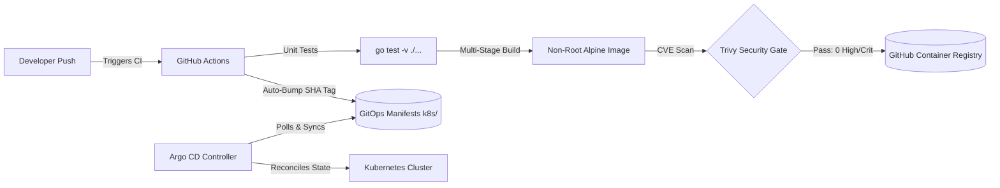

# Cloud-Native DevSecOps & GitOps Microservice Pipeline

[](https://github.com/Veeresh-Shetter/gitops-app/actions/workflows/ci.yml)

An end-to-end, production-hardened CI/CD and GitOps pipeline deploying a lightweight Go microservice to Kubernetes using **Docker, GitHub Actions, Trivy, GHCR, and Argo CD**.

## Architecture & Workflow



## Key Engineering & Security Highlights

* **Shift-Left Testing & DevSecOps Gate:** Runs automated Go unit tests (`go test -v ./...`) before building, followed by an **Aquasecurity Trivy** container scan that blocks `CRITICAL` or `HIGH` OS and Go `stdlib` vulnerabilities prior to registry push.
* **Hardened Multi-Stage Containerization:** Compiles a static Go binary (`CGO_ENABLED=0`, stripped debug symbols with `-ldflags="-s -w"`) inside a minimal `alpine:latest` runtime running under a dedicated non-root user (`appuser`, UID `100`), shrinking the image footprint to **~12 MB** and preventing root privilege escalation.
* **Declarative Pull-Based GitOps:** Isolates application source code from Kubernetes manifests (`k8s/`) and declarative Argo CD configuration (`argocd/application.yaml` with `prune: true` and `selfHeal: true`). CI pushes an immutable `sha-<commit>` tag to GHCR and commits the updated tag back to `k8s/deployment.yaml` with `[skip ci]`, allowing **Argo CD** to reconcile cluster state automatically without exposing cluster credentials to CI. *(Note: Kept in a single mono-repo for self-contained portfolio reproducibility; in multi-team enterprise environments, `k8s/` manifests are separated into a dedicated config repository for stricter RBAC isolation.)*
* **Production Kubernetes Resilience:** Configures explicit CPU/memory requests and limits alongside HTTP `/healthz` `readinessProbe` and `livenessProbe` checks for zero-downtime rolling updates.

## Repository Structure

```text
├── .github/workflows/ci.yml   # Go tests, Trivy CVE scan, GHCR push & GitOps tag bump
├── argocd/
│   └── application.yaml       # Declarative Argo CD Application (automated prune & self-heal)
├── k8s/
│   ├── deployment.yaml        # Non-root pod security context, probes & resource limits
│   └── service.yaml           # ClusterIP / NodePort service routing on port 8080
├── Dockerfile                 # Multi-stage non-root Alpine container build
├── go.mod                     # Go module definition
├── main.go                    # Lightweight Go HTTP microservice with /healthz endpoint
└── main_test.go               # Automated HTTP unit tests for / and /healthz
```

## Quick Verification

1. **Apply Declarative Argo CD Application:**
   ```bash
   kubectl apply -f argocd/application.yaml
   ```
2. **Verify Pod Health & Non-Root Execution:**
   ```bash
   kubectl get pods -l app=gitops-app
   kubectl exec -it deploy/gitops-app-deployment -- whoami
   # Expected output: appuser
   ```
