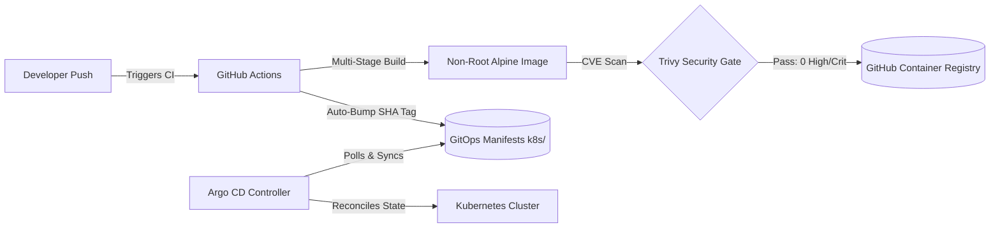

# Cloud-Native DevSecOps & GitOps Microservice Pipeline

An end-to-end, production-hardened CI/CD and GitOps pipeline deploying a lightweight Go microservice to Kubernetes using **Docker, GitHub Actions, Trivy, GHCR, and Argo CD**.

## Architecture & Workflow



## Key Engineering & Security Highlights

* **Hardened Multi-Stage Containerization:** Compiled a static Go binary (`CGO_ENABLED=0`, stripped debug symbols with `-ldflags="-s -w"`) inside a minimal `alpine:3.20` runtime running under a dedicated non-root user (`appuser`, UID `100`), shrinking the image footprint to **~12 MB** and eliminating root privilege escalation risks.
* **Shift-Left DevSecOps Gate:** Integrated **Aquasecurity Trivy** directly into GitHub Actions to scan every built container image for OS and library vulnerabilities, blocking pushes if any `CRITICAL` or `HIGH` CVEs are detected.
* **True Pull-Based GitOps:** Separated application source code from Kubernetes manifests (`k8s/`). Upon passing security checks, CI pushes an immutable `sha-<commit>` image tag to GHCR and commits the updated tag back to `k8s/deployment.yaml` with `[skip ci]`, allowing **Argo CD** to detect drift and reconcile cluster state automatically.
* **Production Kubernetes Resilience:** Configured explicit CPU/memory requests and limits alongside HTTP `/healthz` `readinessProbe` and `livenessProbe` checks to enable zero-downtime rolling updates.

## Repository Structure

```text
├── .github/workflows/ci.yml   # Build, Trivy CVE scan, GHCR push & GitOps tag bump
├── k8s/
│   ├── deployment.yaml        # Non-root pod security context, probes & resource limits
│   └── service.yaml           # ClusterIP / NodePort service routing on port 8080
├── Dockerfile                 # Multi-stage non-root Alpine container build
└── main.go                    # Lightweight Go HTTP microservice with /healthz endpoint
```

## Quick Local Verification

1. **Point Argo CD to `k8s/`:** Configure your Argo CD Application manifest path to `k8s` with automated sync and self-healing enabled.
2. **Verify Pod Health & Non-Root Execution:**
   ```bash
   kubectl get pods -l app=gitops-app
   kubectl exec -it deploy/gitops-app-deployment -- whoami
   # Expected output: appuser
   ```
